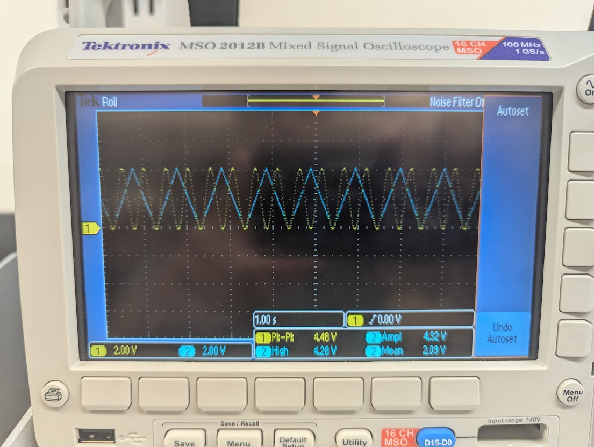

Miguel Pegues's ME433: Advanced Mechatronics repo

If code from a specific assignment stops working, it's most likely because I've updated pegues_lib without guaranteeing compatibility with existing code. Check out the last commit where that assignment was updated and it should work.

# Assignments:
1. [x] [1: Kitchen](https://github.com/ndm736/ME433_2026/wiki/HW1)
2. [x] [2: Set up Pico and servo control in C and Python.](https://github.com/ndm736/ME433_2026/wiki/HW2)
    * [hw2 folder](./hw2/)

      https://github.com/user-attachments/assets/82b65c56-1862-4abd-a83e-c1883e856d33

3. [x] [3: I2C LED Assignment](https://github.com/ndm736/ME433_2026/wiki/HW3)
    * [hw3 folder](./hw3/)

    https://github.com/user-attachments/assets/880ef6e8-003c-4b67-80d8-324bf3797b06

4. [x] [4: I2C OLED and ADC read](https://github.com/ndm736/ME433_2026/wiki/HW4)
    * [hw4 folder](./hw4/)

    https://github.com/user-attachments/assets/634b510a-0e1a-46f5-aa79-fc8a8d8a8de3

5. [x] [5: I2C IMU](https://github.com/ndm736/ME433_2026/wiki/HW5)
    * [hw5 folder](./hw5/)

    https://github.com/user-attachments/assets/b27ff88e-f733-4503-b9ed-5c7de13b1909

6. [x] [6: USB Mouse](https://github.com/ndm736/ME433_2026/wiki/HW6)
    * [hw6 folder](./hw6/)

    https://github.com/user-attachments/assets/526ab64d-ac11-4910-af54-4754fc8acde6

7. [x] [7: SPI DAC](https://github.com/ndm736/ME433_2026/wiki/HW7)
    * [hw7 folder](./hw7)
    

8. [ ] [8: SPI RAM](https://github.com/ndm736/ME433_2026/wiki/HW8)
    * [hw8 folder](./hw8)

9. [x] [9: Filtering](https://github.com/ndm736/ME433_2026/wiki/HW9)
    * [hw9 folder](./hw9)