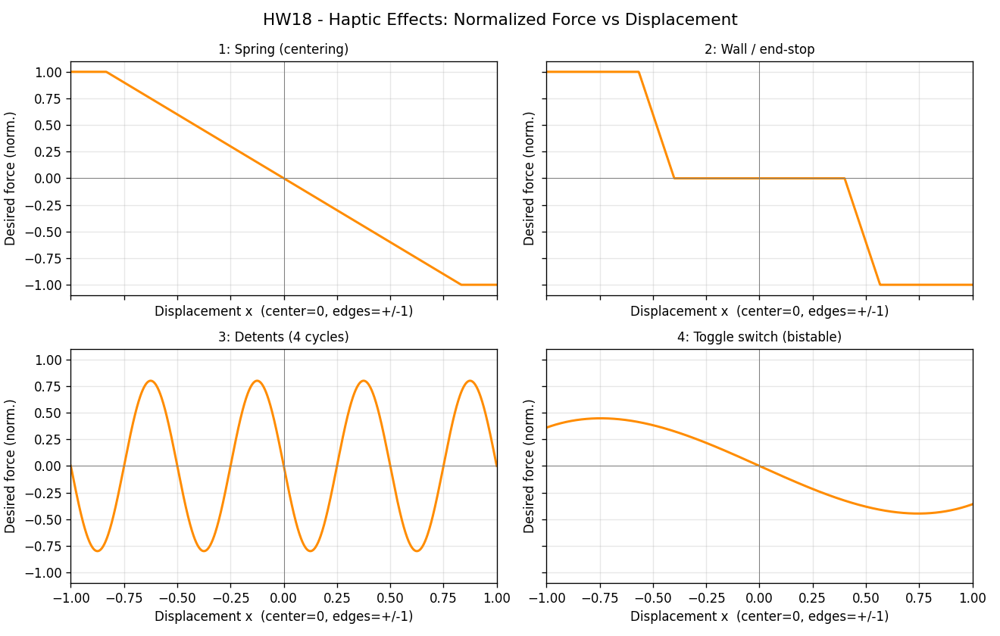
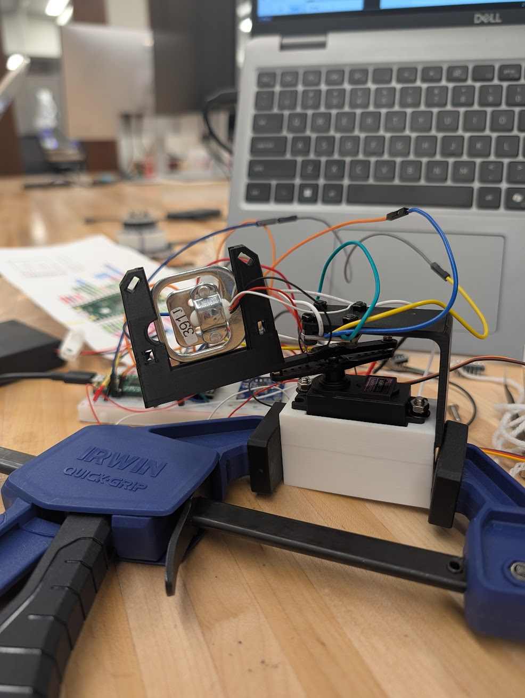
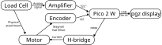

HW18, a collaboration be tween Brendan O'Rourke and Miguel Pegues.

Below are force vs displacement curves for simulating a spring, walls, detents, and a bistable switch

This is the final setup for our paddle. When screwed in as designed, the encoder board is slightly too low, so it's clamped in place instead.

This is a block diagram of our paddle

